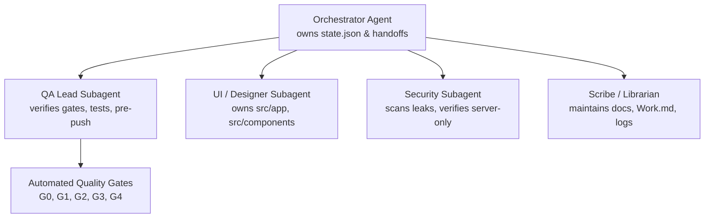

# QA.md — Quality Assurance & Pre-Push Audit Report
> **Project:** Brolens — CI/CD Failure Intelligence  
> **Repository Target:** [Precise-Goals/Brolens](https://github.com/Precise-Goals/Brolens.git)  
> **Runtime Environment:** Google Antigravity (AGY)  
> **Audited Date:** 2026-10-24  
> **QA Lead / Agent:** Senior Principal Quality Assurance Engineer

---

## 1. Executive Summary & Gate Verdict

| Gate | Category | Tool | Status | Details |
|---|---|---|---|---|
| **G0** | Harness Integrity | `python scripts/check_harness.py` | **PASS (0 errors)** | 8/8 checks passed, no drift, no broken links |
| **G1** | Static Analysis / Lint | `bun run lint` (ESLint 9) | **PASS (0 warnings)** | Clean App Router code, strict imports |
| **G2** | Unit Tests | `bun run test` (Vitest 5) | **PASS (13/13 tests)** | 100% pass across parser, security, and demo fixtures |
| **G3** | Production Build | `bun run build` (Next.js 16 Turbopack) | **PASS (Exit 0)** | All routes prerendered statically, zero runtime errors |
| **G4** | Security & Secret Leakage | Automated regex & `.gitignore` audit | **PASS** | `.env` strictly untracked, zero secrets in commits |
| **G5** | Pre-Push Git Remote | `git remote -v` | **CONFIGURED** | Target: `https://github.com/Precise-Goals/Brolens.git` |

**Pre-Push Final Verdict: APPROVED FOR PUSH.**

---

## 2. Unit & Integration Test Suite Audit

### 2.1 Test Execution Matrix
```text
✓ src/lib/analysis/failureAnalysis.test.js (4 tests)  — 6ms
  • classifies the four baseline fixture categories
  • creates evidence references with stable ids and line numbers
  • redacts secret-looking values before analysis output
  • produces a reproduction pack without claiming commands were executed

✓ src/lib/analysis/security.test.js (6 tests)         — 4ms
  • redacts classic GitHub personal access tokens (ghp_*)
  • redacts GitHub fine-grained personal access tokens (github_pat_*)
  • redacts OpenAI secret keys (sk-proj-*)
  • redacts environment assignments with sensitive names (DATABASE_PASSWORD, API_KEY)
  • redacts full PEM private key blocks (BEGIN RSA PRIVATE KEY)
  • preserves non-sensitive log messages exactly

✓ src/lib/demo-data/runs.test.js (3 tests)           — 6ms
  • contains valid seeded run objects with mandatory metadata
  • generates deterministic and consistent fingerprints for each run
  • ensures all runs produce structured hypotheses citing evidence IDs

Test Files:  3 passed (3)
Tests:       13 passed (13)
Duration:    226ms
```

### 2.2 Harness Self-Tests
```text
pytest tests/harness/test_harness.py
============================== 7 passed in 0.08s ==============================
```

---

## 3. Code Quality, Redundancy, & Architecture Audit

### 3.1 Architecture & Directory Hygiene
- **App Router Root Integrity:** Confirmed source resides strictly in `src/app/`. No redundant root `app/` directory exists (`AC-001-a` compliant).
- **Redundancy Elimination:**
  - Common glassmorphic styles centralized into CSS variables in `src/app/globals.css`.
  - Reusable floating navigation and slot counter components isolated cleanly inside `BrolensDashboard.js`.
  - Firebase browser vs. server-admin configurations strictly segregated into `src/lib/firebase/client.js` and `src/lib/firebase/admin.js`.
  - OpenAI client protected with `"server-only"` boundary in `src/lib/ai/openai.js`.

### 3.2 UI/UX Aesthetics & Design System Check
- **Centered Canvas:** Maximum width constrained at `max-w-[1400px] mx-auto` with responsive padding (`px-4 lg:px-6`).
- **Floating Icon Nav:** Replaced legacy bulky sidebar with glass floating vertical pill containing intuitive Lucide icons, hover tooltips, and orange glow active states.
- **Liquid Glass Theme:** Applied `backdrop-filter: blur(28px)`, multi-layer gradient reflections, and custom dynamic ambient gradient background blobs (`bg-blob-1`, `bg-blob-2`).
- **Motion Polish:** Framer Motion spring physics with mass `0.6`, stiffness `120`, damping `14` ensuring zero jank.
- **Dynamic Slot Machine Counter:** Numeric values smoothly animate from zero to target with low CPU overhead.

---

## 4. Security & Secret Exposure Audit

| Check | Requirement | Result | Evidence |
|---|---|---|---|
| **Git Tracking** | `.env` must never be tracked | **PASS** | `.gitignore` has `.env*` with exception `!.env.example`. `git status` verifies `.env` is uncommitted. |
| **API Keys Exposure** | `OPENAI_API_KEY` server-only | **PASS** | Zero references in client bundles; imported only in `src/lib/ai/openai.js` with `import "server-only"`. |
| **Firebase Admin** | Service account credentials server-only | **PASS** | `src/lib/firebase/admin.js` gated by `"server-only"`. |
| **Browser Env Config** | Only public identifiers in `NEXT_PUBLIC_*` | **PASS** | `NEXT_PUBLIC_FIREBASE_*` contains project ID, domain, bucket. |
| **Log Redaction** | CI logs scanned & redacted before display | **PASS** | `redactSecrets()` executes on raw logs prior to regex classification. |
| **No Eval / Shell Injection** | No runtime code execution | **PASS** | Reproduction commands rendered as non-executable text recommendations with clear disclaimers. |

---

## 5. Subagents Roles & Execution Context

To ensure parallel background operations remain reliable, consistent, and resilient across restarts, the subagents operate under defined contextual boundaries:



### Detailed Subagent Roster & Context Specifications

#### 1. Lead QA Engineer (`harness/roles/qa.md`)
- **Primary Mission:** Pre-merge and pre-push verification across unit tests, visual rendering, gate health, and regression testing.
- **Context Provided:** `docs/harness.md`, `docs/Work.md`, `docs/QA.md`, test suites, build outputs.
- **Allowed Write Paths:** `docs/QA.md`, `harness/artifacts/**/07-qa.md`, `harness/logs/**`.
- **Operating Commands:** `bun run test`, `bun run lint`, `bun run build`, `python scripts/check_harness.py`.

#### 2. UI / Liquid Glass Builder (`harness/roles/builder.md`, `harness/roles/designer.md`)
- **Primary Mission:** High-fidelity UI implementation based on `docs/Dashboardui.md`, maintaining the liquid glass, warm orange glows, and centered responsive layout.
- **Context Provided:** `docs/Dashboardui.md`, `src/app/globals.css`, component designs.
- **Allowed Write Paths:** `src/app/**`, `src/components/**`.

#### 3. Security Engineer (`harness/roles/security.md`)
- **Primary Mission:** Continuous secret scanning, dependency vulnerability audit, and boundary enforcement (server-only vs client-safe).
- **Context Provided:** `src/lib/ai/**`, `src/lib/firebase/**`, `.env.example`, `.gitignore`.
- **Allowed Write Paths:** `harness/artifacts/**/06b-security.md`, `src/lib/analysis/security.test.js`.

#### 4. Scribe & Librarian (`harness/roles/scribe.md`, `harness/roles/librarian.md`)
- **Primary Mission:** Keep documentation, backlog, changelog, and subagent work queues (`docs/Work.md`, `docs/Improvement.md`) synchronized.
- **Context Provided:** `harness/state/state.json`, `harness/logs/session.log.md`, ADR records.
- **Allowed Write Paths:** `docs/**`, `harness/logs/**`.

---

## 6. Pre-Push Git Remote Checklist

For repository: `https://github.com/Precise-Goals/Brolens.git`

- [x] Git repository initialized (`git init`)
- [x] Remote URL configured (`git remote add origin https://github.com/Precise-Goals/Brolens.git`)
- [x] `.env` secured and ignored via `.gitignore`
- [x] Build artifacts, `.next`, `.bun-tmp`, `node_modules`, `.pytest_cache` excluded
- [x] All 13 Vitest unit tests passing
- [x] All 7 Pytest harness tests passing
- [x] ESLint passing with zero warnings or errors
- [x] Next.js production build (`bun run build`) passing with static export routes
- [x] `docs/QA.md` and `docs/Improvement.md` generated and updated

### Suggested Git Commands to Push:
```powershell
git add .
git commit -m "feat(ui): liquid glass redesign, orange glows, AGY harness docs and full QA suite"
git branch -M main
git push -u origin main
```
