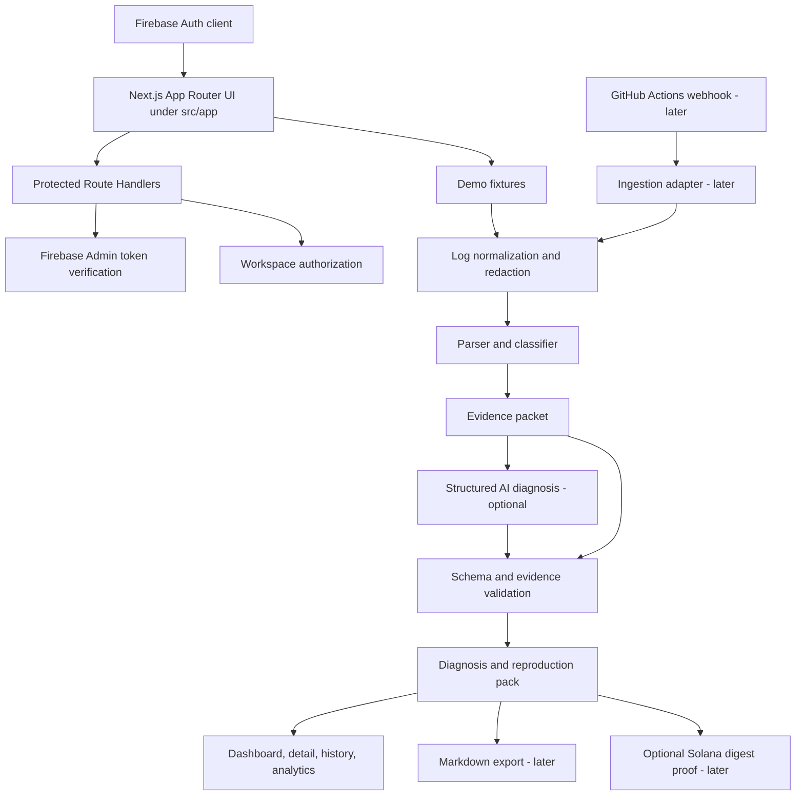

# harness.md - Brolens

## 1. Problem Statement

Brolens is a CI/CD failure intelligence web app for developer teams. It turns failed GitHub Actions-style pipeline runs into evidence-backed diagnoses and Failure Reproduction Packs so developers can move from "CI failed" to "I know what to inspect next and how to reproduce it" with less manual log searching.

Source: `docs/raw.md`. UI reference: `docs/Dashboardui.md`. Operating manual: `docs/prompt.md`.

Current repository state: an existing Next.js App Router project already lives at the repository root with source under `src/app`. Do not create a second root-level `app/` folder.

## 2. Goals & Non-Goals

| id | type | statement |
|---|---|---|
| G-001 | Goal | Deliver a polished dashboard-first Brolens MVP using the existing Next.js project structure. |
| G-002 | Goal | Support Firebase Authentication with email/password and Google sign-in, with server-side ID-token verification for protected APIs. |
| G-003 | Goal | Provide reliable offline/demo seeded workflow failures before depending on live GitHub integration. |
| G-004 | Goal | Extract evidence deterministically, classify at least four failure categories, and generate a structured Failure Reproduction Pack. |
| G-005 | Goal | Clearly separate observed facts, hypotheses, confidence, missing evidence, and recommended next checks. |
| G-006 | Goal | Keep secrets, wallet private keys, raw confidential logs, and source code out of public UI, logs, AI prompts, and blockchain data. |
| NG-001 | Non-goal | Replace GitHub Actions, GitLab CI, Jenkins, CircleCI, or any CI provider. |
| NG-002 | Non-goal | Execute arbitrary customer repository code inside Brolens. |
| NG-003 | Non-goal | Automatically commit fixes, merge pull requests, rerun workflows, deploy, or mutate production infrastructure. |
| NG-004 | Non-goal | Claim guaranteed root cause or label a failure flaky from one failed run. |
| NG-005 | Non-goal | Store wallet private keys, seed phrases, raw logs, report bodies, or confidential metadata on-chain. |
| NG-006 | Non-goal | Implement billing, enterprise SSO, or full multi-provider CI support in the MVP. |

## 3. Users & Use Cases

| user | needs | primary use cases |
|---|---|---|
| Application developer | Understand why a pull request build failed and reproduce it locally. | Open recent failure, inspect highlighted evidence, copy suggested local commands, mark diagnosis helpful. |
| DevOps/platform engineer | Triage recurring build, environment, dependency, and permission failures before escalation. | Review grouped fingerprints, compare occurrences, inspect category trends. |
| Engineering lead/CTO | Understand repeat failure patterns and engineering impact without overclaimed metrics. | View impact analytics, repeat-failure counts, CI minutes, feedback trends. |
| Workspace admin | Manage connected repositories, retention, privacy, and optional integrations. | Configure Firebase-backed workspace access, repository/demo mode, LLM opt-in, deletion controls. |

## 4. Requirements

| id | statement | priority MoSCoW | source |
|---|---|---|---|
| REQ-001 | Use the existing root Next.js App Router project under `src/app`; do not create a redundant root `app/` folder. | Must | user, repo inspection |
| REQ-002 | Replace the starter page with a Brolens dashboard shell using a collapsible sidebar and authenticated workspace layout. | Must | raw 8, Dashboardui |
| REQ-003 | Use the white/orange premium dashboard reference: paper-white base, ink text, orange accents, glass widgets, Bento grid, Lucide icons, and Framer Motion interactions. | Must | Dashboardui |
| REQ-004 | Firebase Auth must support email/password and Google sign-in. | Must | raw 7, raw 9.3 |
| REQ-005 | Protected workspace pages and APIs must verify Firebase ID tokens server-side and authorize workspace access. | Must | raw 9.5, raw 15 |
| REQ-006 | Store Firebase browser config only in `NEXT_PUBLIC_*` environment variables and keep Firebase Admin/server secrets unprefixed and server-only. | Must | raw 9.3, user |
| REQ-007 | Provide seeded/demo workflow run data that works offline and is clearly labeled as demo or sample data. | Must | raw 7.1, raw 8.1 |
| REQ-008 | Dashboard must show recent failed runs, category summaries, repeat failures, and impact metrics without fabricated live claims. | Must | raw 8.1, raw 17 |
| REQ-009 | Failed-run detail must show run metadata, evidence timeline, highlighted log excerpt, change context, diagnosis summary, reproduction pack, next steps, and feedback. | Must | raw 8.3 |
| REQ-010 | Deterministic parser must identify evidence for at least four failure categories before AI assistance. | Must | raw 7.1, raw 16 |
| REQ-011 | Supported MVP categories are `test_failure`, `typecheck_or_lint_failure`, `dependency_resolution_failure`, and `configuration_or_missing_secret`; stretch categories include network, resource, permission, workflow config, flaky, and unknown. | Must | raw 16 |
| REQ-012 | Every diagnosis must cite existing evidence IDs, log line ranges, or job/step references; invented evidence is rejected. | Must | raw 14 |
| REQ-013 | Failure Reproduction Pack must include summary, classification, observed facts, evidence, possible contributors, prerequisites, commands, next checks, uncertainty, source links, timestamp, and analyzer version. | Must | raw 5 |
| REQ-014 | The app must still provide useful deterministic output when AI analysis is unavailable. | Must | raw 15.8, raw 17.3 |
| REQ-015 | Failure history must group incidents by stable fingerprints and avoid flaky labels without comparable run history. | Must | raw 8.4, raw 16.3 |
| REQ-016 | Impact analytics must define each metric and label seeded or estimated values clearly. | Must | raw 8.5, raw 17 |
| REQ-017 | Secret redaction must run before persistence, UI display, AI prompts, or exports. | Must | raw 15.2 |
| REQ-018 | Unit and fixture tests must cover parser rules, evidence references, redaction, fingerprints, and AI schema validation. | Must | raw 17.2, raw 22 |
| REQ-019 | GitHub Actions integration must be read-only and can be deferred until the offline demo journey is reliable. | Should | raw 7.2, raw 19 |
| REQ-020 | Markdown diagnosis export and helpful/not helpful feedback should be included after the core detail view is stable. | Should | raw 7.2 |
| REQ-021 | Optional MetaMask Solana wallet linking may prove wallet ownership by signed challenge only. | Could | raw 22.1 |
| REQ-022 | Optional Solana Devnet proof may anchor only a salted commitment for a sanitized export, never report contents or secrets. | Could | raw 22.1 |
| REQ-023 | Live GitHub App webhooks, Slack notifications, workers, billing, and multi-provider CI are deferred from Sprint 1 unless explicitly pulled in. | Won't | raw 7.3, raw 19 |

## 5. Acceptance Criteria

| id | requirement | Given / When / Then |
|---|---|---|
| AC-001-a | REQ-001 | Given the current project, when implementation begins, then all Next.js pages and routes are created under `src/app` and no root `app/` directory is added. |
| AC-002-a | REQ-002 | Given a user opens the app, when the dashboard loads, then the first screen is the usable Brolens workspace/dashboard experience, not a marketing landing page. |
| AC-003-a | REQ-003 | Given desktop and mobile viewports, when the dashboard renders, then the white/orange glass Bento UI is readable, responsive, and has no overlapping text or controls. |
| AC-004-a | REQ-004 | Given Firebase Auth is configured, when a user signs in with email/password or Google, then the app records an authenticated Firebase user session. |
| AC-005-a | REQ-005 | Given an unauthenticated request reaches a protected route/API, when token verification runs, then the request is rejected with `401`; authorized users without workspace access receive `403`. |
| AC-006-a | REQ-006 | Given environment files are configured, when the app builds, then only Firebase browser config appears in `NEXT_PUBLIC_*` values and no Admin/private credentials are bundled client-side. |
| AC-007-a | REQ-007 | Given no live GitHub connection, when the dashboard loads, then a seeded failed run can be opened and all demo metrics are labeled as demo/sample data. |
| AC-008-a | REQ-008 | Given seeded run data, when the dashboard renders, then it shows total analyzed runs, failures, common categories, repeat failures, recent runs, and metric definitions where needed. |
| AC-009-a | REQ-009 | Given a seeded failed run, when a user opens detail, then the failed job/step, relevant evidence block, diagnosis summary, and reproduction pack are visible. |
| AC-010-a | REQ-010 | Given fixture logs for four categories, when parser tests run, then each fixture produces the expected category and at least one evidence reference. |
| AC-011-a | REQ-011 | Given a category result, when displayed, then confidence and category are sourced from the deterministic classifier or validated AI output. |
| AC-012-a | REQ-012 | Given AI output cites an unknown evidence ID or line, when validation runs, then the AI output is rejected or downgraded and the UI shows deterministic fallback. |
| AC-013-a | REQ-013 | Given a completed analysis, when a reproduction pack is opened, then it includes prerequisites, commands, cautions, next checks, uncertainty, timestamp, and analyzer version. |
| AC-014-a | REQ-014 | Given the AI provider is disabled or fails, when analysis runs, then deterministic evidence, category, and basic reproduction guidance still render. |
| AC-015-a | REQ-015 | Given similar seeded failures, when history renders, then incidents group by fingerprint and do not use `suspected_flaky_failure` without supporting comparable outcomes. |
| AC-016-a | REQ-016 | Given impact metrics display, when values are seeded or estimated, then labels and definitions prevent unsupported time-saved claims. |
| AC-017-a | REQ-017 | Given a fixture containing secret-like values, when parser/redactor tests run, then redacted output contains no secret values in UI, logs, exports, or AI packets. |
| AC-018-a | REQ-018 | Given `bun run test` is configured, when unit tests run, then parser, classifier, redaction, fingerprint, and schema validation tests pass. |
| AC-019-a | REQ-019 | Given GitHub integration is not yet configured, when Sprint 1 demo runs, then no core user journey depends on live GitHub API availability. |
| AC-020-a | REQ-020 | Given feedback/export is implemented, when a diagnosis is marked helpful or exported, then the record/export is scoped to the authorized workspace and contains no raw secrets. |
| AC-021-a | REQ-021 | Given optional wallet linking is enabled, when a user links a wallet, then Brolens stores only the public address and verification metadata after a fresh expiring signed challenge. |
| AC-022-a | REQ-022 | Given optional audit proof is enabled, when a proof is created, then only `BROLENS_AUDIT:v1:<commitment>` or equivalent digest/version data goes on Solana Devnet. |

## 6. Architecture & Tech Stack



Current stack:

| layer | decision |
|---|---|
| Web app | Next.js `16.4.3` App Router in `src/app` |
| UI runtime | React `19.3.0` |
| Styling | Tailwind CSS `4` via `@tailwindcss/turbopack` |
| Package manager | Bun `1.3.14` (`bun.lock`, `packageManager`) |
| Current language | JavaScript files today; TypeScript migration is planned before domain logic expands |
| Auth | Firebase client SDK plus Firebase Admin SDK for server verification |
| Data for Sprint 1 | Local sanitized demo fixtures and in-memory/static modules |
| Database | PostgreSQL planned after offline demo; no database is present today |
| AI | Provider-agnostic server-side wrapper planned; deterministic fallback required |
| Optional blockchain | MetaMask Connect Solana plus Solana Devnet Memo proof after core flow |

Architectural decisions:

| id | decision | rationale |
|---|---|---|
| ADR-0001 | Start with an offline/demo fixture path before live GitHub ingestion. | Keeps the hackathon demo reliable and testable without network dependency. |
| ADR-0002 | Keep parser, classifier, fingerprint, redactor, and reproduction-pack logic in testable library modules, not page components. | Enables unit tests and deterministic fallback. |
| ADR-0003 | Keep Firebase Auth identity separate from workspace authorization. | Firebase proves identity; Brolens workspace membership controls product data access. |
| ADR-0004 | Treat logs, commit messages, source snippets, web output, and AI output as untrusted data. | Prevents prompt injection and accidental tool or UI trust escalation. |
| ADR-0005 | Defer database, GitHub App, AI provider, and Solana proof until the dashboard and deterministic analysis spine are green. | Reduces scope creep and protects the core demo. |

## 7. Project Structure

Current structure to preserve:

```text
openai-metro/
  docs/
    prompt.md
    raw.md
    harness.md
    Dashboardui.md
    Mcp.md
    Mcpguide.md
    McpCheck.md
  public/
  src/
    app/
      globals.css
      layout.js
      page.js
      favicon.ico
  package.json
  bun.lock
  next.config.mjs
  eslint.config.mjs
  jsconfig.json
  .env
```

Target structure after Sprint 0/1 scaffolding:

```text
src/
  app/
    layout.js
    globals.css
    page.js                         # redirects or renders dashboard shell
    (auth)/                         # sign-in/register routes after auth work begins
    (workspace)/
      dashboard/
      repositories/
      runs/[runId]/
      history/
      impact/
      settings/
    api/
      runs/
      diagnoses/
      feedback/
      webhooks/github/              # later
  components/
    layout/
    dashboard/
    runs/
    ui/
  lib/
    demo-data/
    analysis/
    fingerprints/
    redaction/
    firebase/
    export/
docs/
  harness.md
  adr/
  memory/
harness/
  agents/
  roles/
  artifacts/
  logs/
  standards/
  state/
  tools/
scripts/
tests/
```

Ownership lanes:

| lane | write paths | roles |
|---|---|---|
| Harness | `docs/harness.md`, `harness/**`, `scripts/**`, `tests/harness/**`, `AGENTS.md` | Orchestrator, Scribe, Librarian |
| UI/dashboard | `src/app/**`, `src/components/**`, `src/app/globals.css` | Designer, Builder, QA |
| Auth/workspace | `src/lib/firebase/**`, `src/app/(auth)/**`, protected route handlers | Tech Lead, Builder, Security |
| Demo analysis | `src/lib/demo-data/**`, `src/lib/analysis/**`, `src/lib/fingerprints/**`, analysis tests | Test Author, Builder |
| API/ingestion | `src/app/api/**`, `src/lib/github/**` | Builder, Security, Reviewer |
| Optional export/proof | `src/lib/export/**`, `src/lib/audit-proof/**`, optional wallet UI | Builder, Security |

## 8. Commands

Existing commands are from the current `package.json`. Planned commands must be added before the corresponding gate can require them.

| purpose | command | status |
|---|---|---|
| install | `bun install` | current |
| dev | `bun run dev` | current |
| lint | `bun run lint` | current |
| build | `bun run build` | current |
| start | `bun run start` | current |
| format | `bun run format` | planned in Sprint 0 |
| format check | `bun run format:check` | planned in Sprint 0 |
| typecheck | `bun run typecheck` | planned with TypeScript migration |
| unit test | `bun run test` | planned with Vitest |
| unit test watch | `bun run test:watch` | planned with Vitest |
| integration/e2e test | `bun run test:e2e` | planned with Playwright |
| harness self-test | `python scripts/check_harness.py && pytest tests/harness` | planned in Sprint 0 |
| mcpcheck G0 | follow `docs/McpCheck.md` Part A and write `harness/logs/mcpcheck-<date>.md` | planned in Sprint 0 |

No deploy command is authorized for agents.

## 9. Coding & Testing Standards

Coding standards:

- Follow existing Next.js App Router and Tailwind patterns unless a task artifact approves a migration.
- Keep UI components small, semantic, and accessible; use route-level composition for dashboard pages.
- Use library modules for parser, classifier, redactor, fingerprints, Firebase helpers, export helpers, and AI schemas.
- Use `NEXT_PUBLIC_*` only for values safe to expose to the browser.
- Keep server-only credentials, GitHub secrets, database URLs, AI provider keys, and Firebase Admin credentials out of Client Components.
- Treat CI logs, commit messages, source snippets, fetched web content, and AI output as untrusted data.
- Do not use visible in-app copy to explain keyboard shortcuts, visual styling, or implementation details.
- Do not add a redundant root `app/` folder.

UI standards:

- Build a dashboard-first product UI, not a marketing landing page.
- Use Lucide icons for navigation and buttons when the dependency is added.
- Use glass widgets carefully: readable contrast over the warm background is mandatory.
- Use stable responsive dimensions for sidebars, tables, metric tiles, logs, command panels, and counters.
- Text must not overlap or overflow controls; long branches, SHAs, commands, and logs wrap or scroll predictably.
- Cards are for individual widgets and repeated items; avoid nested cards.

Testing standards:

- Unit tests cover parser, classifier, redaction, evidence references, fingerprints, AI output validation, and commitment helpers when added.
- Fixture tests include at least four categories: test failure, typecheck/lint failure, dependency resolution failure, missing config/secret.
- Playwright covers the dashboard-to-run-detail demo path once the UI shell exists.
- Visual QA checks desktop, tablet, and mobile viewports.
- AI tests must prove fallback behavior when AI fails or cites invalid evidence.
- Security tests must prove redaction prevents secret leakage into UI/export/AI packets.

Coverage target:

- Sprint 1 target: meaningful coverage on changed analysis modules.
- Final target: 80 percent changed-line coverage for parser/classifier/redaction/fingerprint modules.

## 10. Tools, APIs & MCP Servers

MCP preset: `fullstack-web`.

Enable during Sprint 0 reconcile:

| tool/server | purpose | approval |
|---|---|---|
| file read/write | edit repo files within role allow-lists | auto with path guard |
| shell | run commands in Section 8 and read-only inspection | auto |
| context7 | current library docs for Next.js, Firebase, testing libraries, Solana when needed | auto |
| github | read repository metadata and future PR/check evidence | auto read, confirm write |
| semgrep | security and secret scanning | auto |
| playwright | e2e and a11y-oriented browser verification | auto |
| chrome-devtools | performance, console, network, and rendering diagnostics | auto |
| shadcn | component registry reference if selected | auto |
| magicui | optional motion/glow references, used sparingly | auto |
| next-devtools | Next.js route/build/runtime diagnostics | auto |

Do not enable by default:

- `falkordb`, `falkordb-readonly`, `sengra-mcp`, `firecrawl`, and `mem0`.
- `sentry` and `linear` wait until app instrumentation and ticket workflow exist.

External APIs:

| API | status | rule |
|---|---|---|
| Firebase Auth | MVP | browser SDK client-side, Admin SDK server-side only |
| Firebase Realtime Database | optional/lightweight only | do not store product records or raw CI logs by default |
| GitHub REST/App/webhooks | Sprint 2 or stretch | read-only, least privilege, signature verification |
| AI provider | Sprint 2 or stretch | server-side wrapper, bounded redacted evidence only, schema validation |
| Solana Devnet | optional/stretch | public digest/version only; no secrets or report text |

## 11. Autonomy & Approval Matrix

| action | agent autonomy |
|---|---|
| Read project files and docs | auto |
| Edit `docs/harness.md` during Mode B | auto for this task |
| Create Sprint 0 harness files after user approval | auto after approval |
| Install dependencies | confirm |
| Add or rotate secrets | user action or confirm; never print secrets |
| Write `.env.local` with public Firebase config | confirm unless explicitly requested |
| Write `.env.example` with placeholders/public config | auto in implementation sprint |
| Run lint/build/test | auto |
| Run dev server for local QA | auto if needed; provide URL |
| Call external APIs or MCP cloud services with project data | confirm unless already in tool registry and allowed |
| Create GitHub App, deploy, push, publish, or spend money | forbidden without explicit approval |
| Database migrations | confirm once DB exists; destructive migrations require explicit approval |
| Delete data, logs, fixtures, or repo files | confirm |
| Wallet/Solana transaction | user must approve in wallet; agents never hold private keys |

## 12. Sprint Plan

Sprint 0 - Harness and foundation:

| task | goal | lane | exit gate |
|---|---|---|---|
| S0-01 | Curate this `docs/harness.md` from `raw.md`, `Dashboardui.md`, and repo inspection. | Harness | User replies `approved`. |
| S0-02 | Reconcile harness scaffold: `AGENTS.md`, roles, agents, standards, tools, state, logs, scripts, harness tests. | Harness | `python scripts/check_harness.py && pytest tests/harness`. |
| S0-03 | Add planned package scripts and dev dependencies for format/test/e2e as approved. | Tooling | `bun run lint`, `bun run build`, new tests green. |
| S0-04 | Create `.env.example` and document Firebase public/server env split. | Security | Secret scan passes; no literal server secrets. |

Sprint 1 - Offline demo walking skeleton:

| task | goal | lanes | exit gate |
|---|---|---|---|
| T-0001 | Replace starter page with Brolens dashboard shell using `src/app`, sidebar, Bento metric grid, demo labels, and responsive visual system. | UI | lint/build plus visual QA. |
| T-0002 | Add seeded CI failure fixtures and demo repository/run model. | Demo data | fixture tests planned and passing. |
| T-0003 | Implement deterministic redaction, evidence extraction, classifier, and fingerprints for four categories. | Analysis | unit tests for each category and secret redaction. |
| T-0004 | Implement failed-run detail and Failure Reproduction Pack view. | UI + analysis | Playwright smoke opens dashboard -> run detail -> reproduction pack. |
| T-0005 | Add Firebase Auth client foundation and protected workspace route/API pattern. | Auth/security | unauthenticated access blocked, server token verification reviewed. |

Sprint 2 - Product depth:

| task | goal | exit gate |
|---|---|---|
| T-0006 | Add diagnosis feedback and Markdown export. | workspace-scoped feedback/export tests pass. |
| T-0007 | Add structured AI diagnosis wrapper with schema validation and deterministic fallback. | invalid evidence is rejected; AI outage fallback passes. |
| T-0008 | Add history and impact analytics polish. | metrics definitions and demo labels verified. |

Sprint 3 - Integrations and optional extensions:

| task | goal | exit gate |
|---|---|---|
| T-0009 | Add read-only GitHub Actions ingestion. | webhook signature, idempotency, least-privilege review pass. |
| T-0010 | Add optional wallet linking and Solana Devnet commitment proof if still desired. | no private key/seed phrase path exists; digest-only proof tests pass. |

Parallel lanes:

- UI lane can run in parallel with demo-data/analysis after Tech Lead defines fixture interfaces.
- Auth/security lane can run after dashboard shell starts, but protected API work must pass Security before QA.
- Optional blockchain work never blocks the core failure-analysis journey.

## 13. Risks & Mitigations

| risk | mitigation |
|---|---|
| Current app is a thin starter shell while `raw.md` describes a full SaaS. | Sprint 1 is narrowed to offline demo journey plus core UI and deterministic analysis. |
| Scope creep into GitHub App, AI, DB, and Solana before core demo works. | Defer integrations to Sprint 2/3 unless explicitly approved. |
| AI invents root cause or evidence. | Deterministic rules first; validate evidence IDs and schema; show fallback. |
| Logs leak secrets. | Redact before persistence/UI/AI/export; unit-test secret-like fixtures; never log raw pre-redaction text. |
| Demo metrics overclaim savings. | Label seeded/estimated data; include metric definitions; avoid unsupported time-saved claims. |
| UI reference could become decorative instead of operational. | Keep dashboard dense, scannable, and developer-tool focused; no landing-page hero. |
| Firebase browser config is mistaken for a secret. | Document public config vs server credentials; restrict API keys and enforce Auth/Security Rules. |
| GitHub/CI gates unavailable because this folder is not a Git repo. | Record assumption; make CI gates planned until repo init or correct parent repo is confirmed. |
| Suggested commands could be harmful if copied blindly. | Reproduction pack states commands are suggestions and were not executed by Brolens. |
| Fingerprints group unrelated failures. | Normalize carefully, test fixtures, show uncertainty, allow future feedback correction. |

## 14. Assumptions

| id | statement | date | status |
|---|---|---|---|
| ASM-001 | Use the existing root Next.js project and `src/app` structure; no new redundant root `app/` folder. | 2026-10-24 | active |
| ASM-002 | Sprint 1 prioritizes a reliable offline/demo flow over live GitHub ingestion. | 2026-10-24 | active |
| ASM-003 | Bun remains the package manager unless the user explicitly asks to migrate. | 2026-10-24 | active |
| ASM-004 | TypeScript is desirable for domain modules, but the current JavaScript app may migrate incrementally. | 2026-10-24 | active |
| ASM-005 | The baseline four categories are test failure, typecheck/lint failure, dependency resolution failure, and missing configuration/secret. | 2026-10-24 | active |
| ASM-006 | Optional Solana proof is stretch work and must not block the core Brolens workflow. | 2026-10-24 | active |
| ASM-007 | This folder is currently not a Git repository; GitHub/CI gates are planned until repo status is corrected. | 2026-10-24 | active |
| ASM-008 | `docs/Mcp.md`, `docs/Mcpguide.md`, and `docs/McpCheck.md` are the existing MCP references; Sprint 0 can normalize casing or create pointers if needed by the harness checker. | 2026-10-24 | active |

## 15. Open Questions

None blocking Sprint 0 or Sprint 1. The assumptions in Section 14 are active and can be vetoed by the user before implementation or scaffold work.

## 16. Definition of Done

Global DoD for any implementation task:

- Required task artifacts exist under `harness/artifacts/<TASK-ID>/` after Sprint 0 scaffold.
- Acceptance criteria mapped to the task have automated tests or recorded manual evidence.
- `bun run lint` and `bun run build` pass.
- Unit tests pass once `bun run test` is introduced.
- Playwright/e2e smoke passes for UI journeys once `bun run test:e2e` is introduced.
- No new secrets, private keys, seed phrases, tokens, raw confidential logs, or server credentials appear in client bundles, docs, logs, or exports.
- UI has responsive desktop/mobile verification with no overlaps or unreadable cards.
- Facts, hypotheses, confidence, and uncertainty are visibly separated.
- No skipped/disabled tests are added to make gates pass.
- Reviewer reports zero blocker/major issues.
- Security reports zero high/critical findings.
- `AGENTS.md`, harness state, logs, and lessons are updated after Sprint 0 exists.

Task-specific MVP DoD:

- A seeded failed run opens from the dashboard.
- The parser highlights the relevant error block in the right job/step.
- The diagnosis references real evidence IDs/lines.
- The reproduction pack shows commands, prerequisites, and caveats.
- Four baseline categories have tested fixtures.
- AI failure still leaves useful deterministic output.
- No fixture secret is exposed in UI, logs, AI packet, or export.

## 17. Glossary

| term | meaning |
|---|---|
| Brolens | CI/CD failure intelligence SaaS described in `docs/raw.md`. |
| Failure Reproduction Pack | Structured output containing evidence, classification, reproduction commands, caveats, next checks, uncertainty, links, and analysis metadata. |
| Evidence ID | Stable reference such as `E1` pointing to a redacted log excerpt, line range, job/step, or metadata fact. |
| Observed fact | Claim directly supported by logs or metadata. |
| Hypothesis | Possible cause or contributor that is plausible but not proven. |
| Fingerprint | Stable normalized signature used to group similar failures. |
| Demo data | Seeded data used for reliable offline demonstration; must be labeled. |
| Firebase browser config | Public project identifiers in `NEXT_PUBLIC_*`; not equivalent to server credentials. |
| Firebase Admin credential | Server-only credential used to verify ID tokens; never exposed to browser code. |
| CI provider | External system such as GitHub Actions that executes workflow runs. |
| Redaction | Removal or masking of secret-like values before persistence, display, AI, or export. |
| Commitment | Salted SHA-256 digest for optional audit proof; it is not the report content. |
| Devnet | Solana test network for prototype proof transactions. |

## 18. AGY Agent Configuration

### 18.1 Runtime Transition: Codex CLI → AGY (Antigravity)

Brolens migrated from Codex CLI to **AGY (Antigravity)**. All harness roles, artifacts, and state schemas are unchanged; only invocation and coordination differ.

| aspect | Codex CLI (legacy) | AGY (current) |
|---|---|---|
| Runtime | `codex` CLI subprocess | Antigravity IDE / `agy` CLI |
| Agent model | OpenAI models | Claude Sonnet 4.6 (thinking) → Gemini 2.0 Flash High (planned) |
| Parallelism | Sequential by default | Native parallel subagents via `invoke_subagent` |
| State | `harness/state/state.json` | Same — read on every subagent boot |

### 18.2 Model Plan

| phase | model | rationale |
|---|---|---|
| Current (Sprint 1–2) | Claude Sonnet 4.6 (thinking) | Deep reasoning; planning and architecture |
| Future (Sprint 3+) | Gemini 2.0 Flash High | Cost-optimal at scale |

Model routing is in `docs/Work.md` Section 7. Upgrade path requires only the `invoke_subagent` `Model` parameter change.

### 18.3 Parallel Subagent Architecture

Each harness lane maps to one `invoke_subagent` call. The orchestrator coordinates all lanes via `send_message`.

- **`Workspace="branch"`** — isolated clone for lanes writing source files (prevents merge conflicts).
- **`Workspace="inherit"`** — harness/docs-only lanes that do not touch source code.
- Each subagent reads `harness/state/state.json` on boot, then reports via `send_message(Recipient=parentId)`.

### 18.4 Harness Roles → AGY Subagent Mapping

| harness role | workspace mode | artifact |
|---|---|---|
| orchestrator (parent) | inherit | state/logs |
| po-spec | inherit | `01-spec.md` |
| designer | branch | `02-design.md` |
| tech-lead | inherit | `03-plan.md` |
| test-author | branch | `04-tests.md` |
| builder | branch | `05-build.md` |
| reviewer | inherit | `06-review.md` |
| security | inherit | `06b-security.md` |
| qa | inherit | `07-qa.md` |
| scribe | inherit | `08-docs.md` |
| librarian | inherit | memory updates |

Each subagent `Prompt` includes: role file path, current task ID from state, lane ownership constraints, and instruction to `send_message` on completion or blockage.

### 18.5 Background Task Monitoring

| mechanism | tool | use case |
|---|---|---|
| One-shot timer | `schedule(DurationSeconds=N)` | Timeout a long-running build |
| Recurring check | `schedule(CronExpression="*/5 * * * *")` | Poll build status |
| Task inspection | `manage_task(Action="status", TaskId=id)` | Inspect a running shell command |

Background tasks are registered in `docs/Work.md` §3. AGY auto-resumes the orchestrator on subagent message, task completion, or timer fire — no polling loops needed.

### 18.6 MCP Servers Available in AGY

| server | purpose | primary roles |
|---|---|---|
| `playwright` | E2E browser testing, visual QA | qa, builder |
| `shadcn` | Component registry lookup | designer, builder |
| `magicuidesign-mcp` | Motion/glow UI references | designer |
| `next-devtools` | Next.js route/build diagnostics | builder, qa |
| `sequential-thinking` | Complex planning chains | tech-lead, orchestrator |
| `linear` | Issue tracking, sprint management | orchestrator, scribe |

### 18.7 AGY Skills Available

| skill | use |
|---|---|
| `agy-customizations` | Creating AGY skills, rules, plugins, hooks, MCP servers |
| `android-cli` | Android CLI and AVD management |
| `antigravity-guide` | AGY quick-reference, slash commands, keybindings |

### 18.8 State Persistence & Boot Sequence

`harness/state/state.json` is the single authoritative source. AGY subagent boot order:

1. Read `harness/state/state.json` — determine `mode`, `currentTask`, `budgets`.
2. Read `docs/Work.md` — check lane registry, background tasks, escalation queue.
3. Read role file `harness/roles/<role>.md`.
4. Read task artifact `harness/artifacts/<TASK-ID>/` if it exists.
5. Execute within lane file-ownership constraints (Section 7).
6. Update `docs/Work.md` lane registry before sleeping or reporting done.

The orchestrator is the **only** agent that writes `harness/state/state.json`. All others append only to `harness/logs/events.jsonl` and their lane-owned paths.

### 18.9 Inter-Agent Communication & Circuit Breaker

**Communication:**

| action | tool | direction |
|---|---|---|
| Start lane | `invoke_subagent(TypeName="self", Workspace="branch"/"inherit")` | Orchestrator → subagent |
| Direct subagent | `send_message(Recipient=conversationId)` | Orchestrator → subagent |
| Report done/blocked | `send_message(Recipient=parentId, Message="DONE/BLOCKED: ...")` | Subagent → orchestrator |
| Kill all | `manage_subagents(Action="kill_all")` | Orchestrator only |

Subagents never communicate directly — all coordination routes through the orchestrator.

**Circuit Breaker:** On trip (from `harness/state/budgets.json` or critical failure): call `kill_all`, log to `events.jsonl`, set state `mode` to `"halted"`, surface issue to user, halt. No further action until user resumes.

### 18.10 Secrets Rules (AGY Context)

| rule | detail |
|---|---|
| `OPENAI_API_KEY` is server-only | Never in `NEXT_PUBLIC_*`, client bundles, logs, or AI prompts |
| Firebase browser config is public | `NEXT_PUBLIC_FIREBASE_*` are project identifiers, not secrets |
| Firebase Admin is server-only | `FIREBASE_ADMIN_*` and service account JSON never client-side |
| No secrets in subagent prompts | Never pass literal credentials in `invoke_subagent` `Prompt` |
| No secrets in `send_message` | Messages must never contain literal tokens or private keys |
| Redact before AI | Log content sent to AI must pass through `src/lib/redaction/` first |

Aligns with `AGENTS.md` Rules 3–5 and `REQ-017`.
